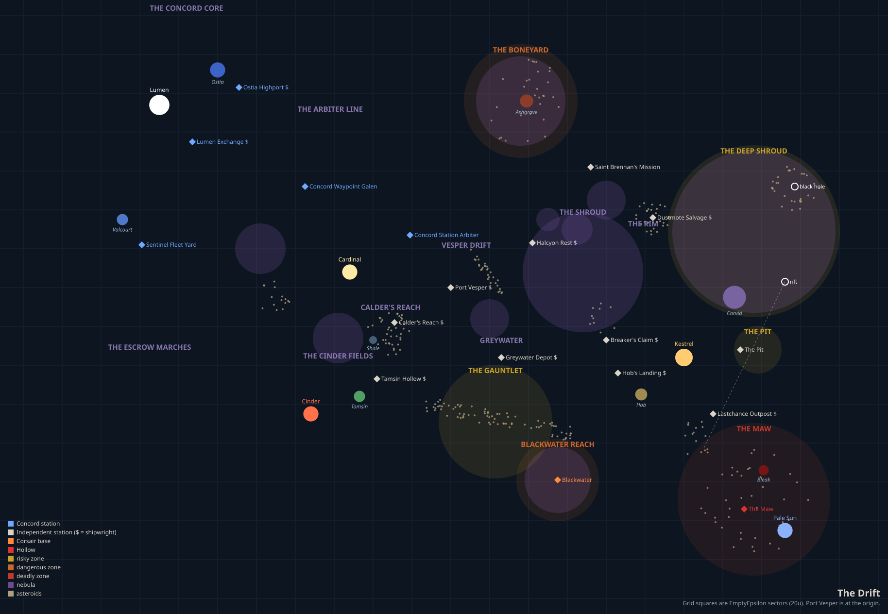

# ragtag-ee — EmptyEpsilon sandbox campaign

> **For players**: This document is for developers and server operators. If you're playing the campaign, see **[The Drift: Player Guide](docs/PLAYER_INTRO.md)** for universe lore, factions, and regions.
>
> **For GMs**: See **[GM Operations Guide](docs/GM_GUIDE.md)** for session pacing, the story arcs, and Director tips.

**Space-western at the edge of settled space.** Command a ragtag freighter making your way in a frontier cluster of five suns—trade, fight, explore, and survive in a living universe of trade lanes, frontier stations, and pirate havens.

Ragtag is a custom scenario script for [Empty Epsilon](https://github.com/daid/EmptyEpsilon), the open-source spaceship bridge simulator, with an optional AI director: a local language model that watches the session and keeps notes and summaries for the GM. It observes only; it does not change the game.

> **Requires Empty Epsilon EE-2026.09.22PR or newer.** It has only been tested on the EE-2026.09.22PR pre-release.

Two scenarios: **The Drift**, the persistent campaign, and **The Short Haul**, a timed race between
crews to make the most money (15, 30 or 60 minutes; nothing saved). Player and GM guides are in
[docs/](docs/).



---

## What's Provided

### A Rich Sandbox Universe
**The Drift** — a persistent, data-driven universe with:
- **16 stations** across 5 suns, from rich Concord Core worlds to lawless Rim outposts
- **21 regions** with varying danger levels (safe, risky, dangerous, deadly)
- **Dynamic trade traffic**: AI freighters following trade routes, docking and departing
- **Salvage economy**: 25+ salvage clusters (credits, missiles, hull patches) respawn each session
- **Progressive upgrades**: 36 upgrades in 11 lines (hull, shields, beams, missiles, tubes, engines, thrusters, reactor, engineering crew, sensors, probes), each line sold at the shipwrights that specialise in it, plus a fake transponder code (a 500 cr consumable; availability earned in-game)
- **Proximity spawn system**: faction patrols that scale with player strength, region danger, and reputation (see below)
- **Gun platforms** (contributed by Kuri148): old Relic guns standing in the Boneyard
- **Four story arcs** for the campaign ship, unlocked by standing and upgrade investment (Rezkov, then the Ledger, the Boneyard and the Corsairs)

### Five Factions
- **Concord**: Government military. Patrol the trade lanes, enforce the law, winners of the Settlement War
- **Independents**: Traders, salvagers, drifters—people making their way
- **Corsairs**: Pirates and raiders. Fast ships, ambush tactics, fortified haven
- **Relic Drones**: Automated war machines from 20 years ago, still guarding the Boneyard (with its old gun platforms)
- **The Hollow**: Unknown faction from the Maw. Extremely hostile. Don't go there.

### Eight Job Types
Stations offer paid contracts ("Any work available?"). Pay scales with the type:

1. **Delivery** (1.0x pay): Ferry cargo between stations. Baseline income, safest option.
2. **Salvage** (1.2x pay): Recover cargo pods from coordinates. Moderate risk.
3. **Hacking** (1.4x pay): Breach a comms relay for intelligence. Technical challenge.
4. **Destroy** (1.6x pay): Eliminate a hostile target. Combat-focused.
5. **Boarding** (1.8x pay): Disable and board a target ship. Highest difficulty and reward.

plus **Escort** (bring a convoy through an ambush), **Tailing** (shadow a ship to a covert meeting) and **Tow**
(bring a broken-down ship home on a tow line).
Which types a ship is offered depends on how much that ship has invested in upgrades.

**Dynamic Compensation**: Rewards scale with distance and the danger level of the region.

**Several ships**: more than one player ship can work the board. A job belongs to the ship that
took it; each ship has its own credits, standing, upgrades and two-job limit. Story arcs belong to
the primary ship.

### Proximity Spawn System

Ambient faction patrols are driven by `ee/ragtag/world/proximity.lua`, not hard-coded encounter tables. Every 8 seconds the system checks which zone each player ship is in and whether conditions allow a new spawn. A patrol hunts the ship that drew it and judges it by that ship's own standing; zone cooldowns are shared, so ships flying together draw no more patrols than one ship.

**Spawn strength** is the sum of two numbers:
- **Player tier**: 0 (0–1 upgrades) · 1 (2–4 upgrades) · 2 (5+ upgrades)
- **Zone modifier**: +0 (danger 0) · +1 (danger 1) · +2 (danger 2–3)

Combined tier maps to a ship group: scout → light → medium → heavy (capped at heavy). Concord zones always send a single Atlantis X23.

**Zone table:**

| Region | Faction | Behavior | Cooldown |
|---|---|---|---|
| Concord Core | Concord | Comms-first shake-down (see below) | 10 min |
| Arbiter Line | Concord | Comms-first shake-down | 12 min |
| the Shroud, Halcyon Rest, the Deep Shroud | Shroud Raiders (hostile whatever the Corsair standing; no standing of their own) | Attack | 4 min |
| the Gauntlet, Blackwater Reach | Corsairs | Attack | 3 min |
| the Boneyard | Relic | Attack on sight, don't negotiate, WX-Lindworm/Stalker templates | 3 min |
| the Maw | Hollow | Attack on sight, no comms | 2 min |

**Throttles** (per zone; the GM sets each zone to None / Low / Medium / High, default Medium):
the zone's cooldown (halved on High, doubled on Low) · a cap on patrol ships alive in the zone
(6 / 12 / 24; Concord zones: 1) · no spawn when enough hostiles are already within 10U (3 / 6 / 12)
· one patrol per 18U map cell · no spawn within 15U of any station.

**Leash system (station safety):** Spawned ships are leashed to their region. When the player exits a region, the group is ordered back to its spawn point; after 120s without the player returning it despawns. Any patrol ship that comes within 15U of a friendly station is despawned immediately.

**Concord shake-down:** the patrol approaches without attacking. Within 5U it drops a warp jammer behind the ship (1U range, 10 hull), brakes it to a stop, and hails. Relay has one minute to answer; each of two stalling replies buys another minute. What happens next depends on Concord standing:

| Concord standing | Outcome |
|---|---|
| ≥ 500 | Callsign recognised: clean pass with a compliment |
| ≥ 200 | Clean pass |
| ≥ 0 | "Nothing flagged. Move along." |
| ≥ −200 | A 100-credit fine (+100 standing if paid; refusing turns the patrol hostile) |
| < −200 | No shake-down: patrols spawn hostile |

Ignoring the hail (−100), fleeing past 10U (−100), destroying the jammer (−50) or telling them where to file it (−150) all cost standing; the first and last turn the patrol hostile. Hostile Concord ships drop combat warp jammers on the ship when within 5U (one per ship at a time, two minutes each).

**Reputation effects on cooldowns:** Corsair standing ≤ −200 shortens Corsair cooldowns by 30%, ≤ −400 by 50%.

**When spawns are suppressed:**
- A story arc has suspended the zone (`PROX.suspendZone`) or locked the job board
- The GM has set the zone to None, or switched the plugin off (World Plugins menu)
- The zone's ship cap, hostile-density limit or cooldown says no; or the spawn point falls inside a station's 15U exclusion

**Events:** each spawn emits a `prox_spawned` event and each cleared group `prox_cleared` (`RT.emit`); the AI director, if running, hears them.

---

### Reputation System
Standing with each faction, kept per ship (see [docs/REPUTATION.md](docs/REPUTATION.md)):
- Completing a job: + the job's reward, with the faction of the station that posted it
- Failing or abandoning a job: − the job's reward
- Destroying a ship that wasn't your enemy: −200 with its faction (fighting off attackers costs nothing)
- Standing below 0 with a faction means fewer job offers at its stations; below −400, none
- Concord standing decides how its patrols treat the ship (above)

### Persistent Campaign
- **Credits, standing and upgrades** carry between sessions, per ship
- **Campaign saves** per campaign, stored in EmptyEpsilon's script storage; six GM backup slots
- **Multi-session progression**: start with a basic freighter, work your way to military-grade

---

## Installation

### Requirements
- Empty Epsilon **EE-2026.09.22PR or newer** (only tested on the EE-2026.09.22PR pre-release)
- For the repository tools and the optional AI director: Python 3.11+, Lua 5.4

### From a release (players and GMs)

1. Download the latest `ragtag-N.zip` from [Releases](https://github.com/sphasse/ragtag-ee/releases).
2. Unzip it into your EmptyEpsilon folder (on macOS: `EmptyEpsilon.app/Contents/Resources`), merging
   its `scripts/` folder. Upgrading? Delete the old `scripts/ragtag` folder first (your campaign save
   is not in it).
3. Start EmptyEpsilon and pick **The Drift** or **The Short Haul** on the server.

### From the repository (server operators and developers)

1. **Install the framework and scenarios:**
   ```bash
   python tools/install.py --ee /path/to/EmptyEpsilon
   ```
   The path should contain the `scripts/` folder. Re-run after pulling updates.

2. **Enable HTTP API** (required for AI director, optional otherwise):
   - Edit `options.ini` and set `httpserver=8080`
   - Windows: `options.ini` is in the EmptyEpsilon folder
   - Linux/macOS: `~/.emptyepsilon/options.ini`

3. **Start EmptyEpsilon** and select **The Drift** (or **The Short Haul**) from the scenario list

4. **Configure campaign settings:**
   - Campaign: Continue (preserves credits/upgrades) or Fresh start
   - Starting Credits: Modest (200cr), Comfortable (500cr), or Well-off (1000cr)
   - Director: On (report events to the AI director if it is running) or Off. The game plays the same either way.

---

## Optional: AI Director

An AI director on a separate PC watches the session through the game's HTTP API and helps the
GM keep track of it. **It is observation-only**: the model can leave the GM a private note, and
nothing else. It cannot hail the crew, spawn anything or change the campaign. The GM can send a
line to the crew ("say") or set the objective from the director's web console.

### AI PC Setup

1. **Install a local model server** ([Ollama](https://ollama.com) recommended):
   ```bash
   ollama pull qwen2.5:14b  # or llama3.1, mistral, etc.
   ```

2. **Configure context length** (critical):
   ```bash
   export OLLAMA_CONTEXT_LENGTH=8192
   ollama serve
   ```

3. **Configure the director:**
   ```bash
   cd director
   cp config.example.toml config.toml
   # Edit config.toml: set EE server URL and model name
   ```

4. **Test connections:**
   ```bash
   python main.py --probe
   ```

5. **Run the director:**
   ```bash
   python main.py
   ```
   Open `http://localhost:8765/` for the GM console.

### Director Features
- **A live view of the session**: events, the ships' state, active jobs, story beats
- **Notes for the GM**: the model summarises what is happening as private GM notes
- **Campaign memory**: a summary of each session, kept for the next one
- **GM console actions**: speak to the crew as a station or ship, set the objective, rename the ship, restore a campaign save (the model can help draft the text; the GM sends it)

---

## Running a Session

### For the GM
- **Campaign buttons**: Campaign Status, Reputation, Jobs, Ship Upgrades (per ship), World Plugins, Missions (story arcs), campaign backup and restore
- **Job generation**: Stations offer procedural contracts weighted by type and by the asking ship's tier
- **Encounter spawns**: Patrols spawn by zone (see Proximity Spawn System)
- **Director console** (if running): the session at a glance, notes from the model, lines to the crew

### For the Crew
- **Station docking**: Request work, buy upgrades, hear rumors
- **Jobs**: up to two contracts at a time per ship, listed on Relay (each with a "Time left" countdown under it)
- **Credits**: each ship's balance is a `Credits: N` line on Relay and Operations
- **Reputation tracking**: changes are logged to the ship's log; the full picture is on the GM Campaign Status screen
- **Persistent progress**: Credits and upgrades carry between sessions

---

## File Structure

| Path | What | Who edits |
|---|---|---|
| `ee/ragtag/` | Lua framework (installed to `scripts/ragtag/`) | Framework contributors |
| `ee/ragtag/core/` | Core pieces: ship records and upgrades, reputation, stations, the event bus | Framework contributors |
| `ee/ragtag/jobs/`, `missions/`, `world/` | Job types, story arcs, world plugins (patrols, defenders, salvage, traffic, rumors, Science DB) | Contributors |
| `ee/ragtag/director.lua` | The AI director's mailbox (listens to the event bus; observation only) | Framework contributors |
| `ee/ragtag/verse/drift.lua` | Base universe data | Rarely (see CONTRIBUTING.md) |
| `ee/ragtag/verse/extensions/` | Community universe additions | Anyone |
| `scenarios/sandbox/` | Sandbox campaign scenario | Contributors |
| `director/` | AI director (Python, stdlib only) | Contributors |
| `tests/` | In-game regression tests: `arcs/`, `jobs/`, `world/`, `core/` | Contributors |
| `tools/` | Validation, installation, testing tools | Contributors |
| `docs/` | Player guides, setting lore, GM references | Contributors |
| `.claude/skills/` | Claude Code skill with EE scripting knowledge | Maintainers |

**Separation of concerns**: Universe data (stations, regions, factions) is decoupled from scenarios. Scenarios reference universe places by name. `tools/check.py` validates that no universe change breaks existing scenarios.

---

## Testing

```bash
# Validate everything
python tools/check.py

# Full headless test (Linux)
tools/ci_headless.sh

# Smoke test: start a headless game with a throwaway save, test it, stop it (any platform)
python3 tools/smoke_test.py --launch <EmptyEpsilon dir>

# Smoke test against a server that is already running
python tools/smoke_test.py --ee http://localhost:8080

# In-game regression tests: story arcs, jobs, world plugins, core
# (starts its own headless EmptyEpsilon per test file, in parallel; a couple of minutes)
python3 tools/game_tests.py --ee <EmptyEpsilon dir>
python3 tools/game_tests.py --ee <EmptyEpsilon dir> world          # one folder
python3 tools/game_tests.py --ee <EmptyEpsilon dir> world/proximity -v
```

Against a running server (`--ee`) the smoke test modifies that server's campaign save, so don't
point it at your real campaign. `--launch` and the game tests use a throwaway save of their own.

---

## Troubleshooting

| Symptom | Fix |
|---|---|
| `--probe`: EmptyEpsilon not reachable | Check `httpserver=8080` in `options.ini`, restart server, check firewall |
| Director says "scenario mailbox empty" | Start a scenario with Director setting set to On |
| GM screen says "AI director offline" | Director not running or can't reach server |
| Director connected but writes no notes | Check console for model errors, verify context length ≥8192 |
| Model's actions show as rejected | Expected for anything but `gm_note`: the director is observation-only |
| Model replies cut off or ignore rules | Increase context length or use larger model |
| LUA-Error in EmptyEpsilon | Check `EmptyEpsilon.log` for file/line number |

---

## Contributing

Universe extensions, new scenarios, and mission types are welcome.

**Start here:**
- [CONTRIBUTING.md](CONTRIBUTING.md) — Guidelines and conventions
- [docs/architecture.md](docs/architecture.md) — System design
- [CLAUDE.md](CLAUDE.md) — If using Claude Code

**Key principle**: Universe changes must not break existing scenarios (`check.py` enforces this).


---

## License

MIT License. See LICENSE file for details.

EmptyEpsilon is a separate project: https://daid.github.io/EmptyEpsilon/
