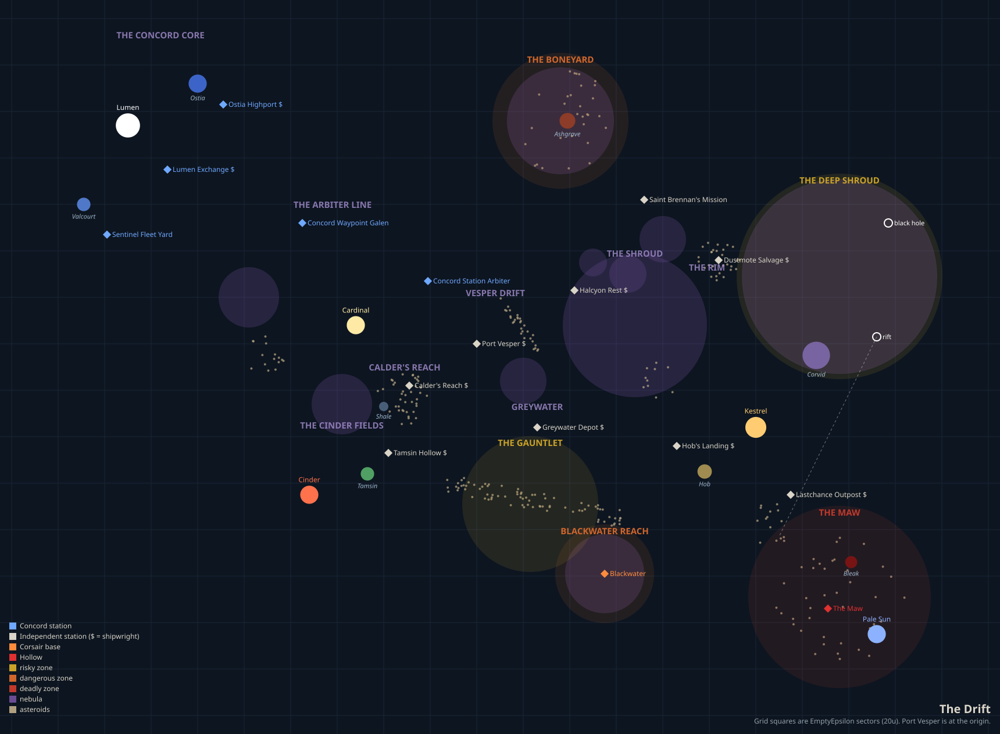

# ragtag-ee — EmptyEpsilon sandbox campaign

**Space-western at the edge of settled space.** Command a ragtag freighter making your way in a frontier cluster of five suns—trade, fight, explore, and survive in a living universe of trade lanes, frontier stations, and pirate havens.

Built for [EmptyEpsilon](https://daid.github.io/EmptyEpsilon/) (2024+ ECS engine), with an optional AI director that voices characters and times encounters using a local language model.



---

## What's Provided

### A Rich Sandbox Universe
**The Drift** — a persistent, data-driven universe with:
- **16 stations** across 5 suns, from rich Concord Core worlds to lawless Rim outposts
- **17 distinct regions** with varying danger levels (safe, risky, dangerous, deadly)
- **Dynamic trade traffic**: 15 AI freighters following realistic routes, docking and departing
- **Salvage economy**: 25+ salvage clusters (credits, missiles, hull patches) respawn each session
- **Progressive upgrades**: 16 total upgrades across different shipyards (shields, weapons, engines, jump drive)
- **Procedurally spawned hazards**: hostile encounters scaled by region danger level

### Five Factions
- **Concord**: Government military. Patrol the trade lanes, enforce the law, winners of the Settlement War
- **Independents**: Traders, salvagers, drifters—people making their way
- **Corsairs**: Pirates and raiders. Fast ships, ambush tactics, fortified haven
- **Relic Drones**: Automated war machines from 20 years ago, still guarding the Boneyard
- **The Hollow**: Unknown faction from the Maw. Extremely hostile. Don't go there.

### Five Mission Types
Progressive difficulty and compensation:

1. **Delivery** (1.0x pay): Ferry cargo between stations. Baseline income, safest option.
2. **Salvage** (1.2x pay): Recover cargo pods from coordinates. Moderate risk.
3. **Hacking** (1.4x pay): Breach comms relay systems for intelligence. Technical challenge.
4. **Destroy** (1.6x pay): Eliminate hostile targets completely. Combat-focused.
5. **Boarding** (1.8x pay): Disable and board target ships. Highest difficulty and reward.

**Dynamic Compensation**: All missions scale rewards by distance and region danger level. A boarding mission 30U away in deadly space (The Maw) pays 3-4x more than a delivery in safe space.

### Reputation System
Track standing with all factions:
- Complete missions: +10 reputation with contract origin faction
- Destroy ships: -10 reputation with their faction
- Reputation affects station access and future opportunities

### Persistent Campaign
- **Credits and upgrades** carry between sessions
- **Campaign saves** per ship, stored in EmptyEpsilon's script storage
- **Multi-session progression**: start with a basic freighter, work your way to military-grade

---

## Installation

### Requirements
- EmptyEpsilon 2024+ (ECS engine—must have `toJSON` function)
- Python 3.11+ (for tools and optional AI director)
- Lua 5.4 (for validation tools)

### Game Server Setup

1. **Install the framework and scenarios:**
   ```bash
   python tools/install.py --ee /path/to/EmptyEpsilon
   ```
   The path should contain the `scripts/` folder. Re-run after pulling updates.

2. **Enable HTTP API** (required for AI director, optional otherwise):
   - Edit `options.ini` and set `httpserver=8080`
   - Windows: `options.ini` is in the EmptyEpsilon folder
   - Linux/macOS: `~/.emptyepsilon/options.ini`

3. **Start EmptyEpsilon** and select **Sandbox: Open Play** from the scenario list

4. **Configure campaign settings:**
   - Campaign: Continue (preserves credits/upgrades) or Fresh start
   - Starting Credits: Modest (200cr), Comfortable (500cr), or Well-off (1000cr)
   - Difficulty: Easy, Normal, or Hard
   - Danger Level: Relaxed, Normal, or Dangerous
   - Director: On (with AI) or Off (scripted fallbacks only)

---

## Optional: AI Director

An AI director on a separate PC voices characters, answers hails, and times encounters dynamically.

### AI PC Setup

1. **Install a local model server** ([Ollama](https://ollama.com) recommended):
   ```bash
   ollama pull qwen2.5:14b  # or llama3.1, mistral, etc.
   ```

2. **Configure context length** (critical):
   ```bash
   export OLLAMA_CONTEXT_LENGTH=8192
   ollama serve
   ```

3. **Configure the director:**
   ```bash
   cd director
   cp config.example.toml config.toml
   # Edit config.toml: set EE server URL and model name
   ```

4. **Test connections:**
   ```bash
   python main.py --probe
   ```

5. **Run the director:**
   ```bash
   python main.py
   ```
   Open `http://localhost:8765/` for the GM console.

### Director Features
- **Plain-English instructions**: "Have the patrol hail them about the cargo"
- **Dynamic pacing**: Twist, escalate, ease off buttons
- **Character voices**: NPCs respond to hails with model-generated dialogue
- **Campaign memory**: Tracks session outcomes and voiced characters
- **Action approval mode**: Review all AI actions before execution

---

## Running a Session

### For the GM
- **Campaign buttons**: Manage credits, save progress
- **Mission generation**: Stations offer procedural missions weighted by type
- **Encounter spawns**: Hostile ships spawn in dangerous regions (scaled by danger level)
- **Director controls** (if enabled): Fire beats, give instructions, approve actions

### For the Crew
- **Station docking**: Request work, buy upgrades, hear rumors
- **Mission types**: Visible in job board with type labels: (delivery), (salvage), (boarding), (hacking), (destroy)
- **Reputation tracking**: Visible on GM Campaign Status screen
- **Persistent progress**: Credits and upgrades carry between sessions

---

## File Structure

| Path | What | Who edits |
|---|---|---|
| `ee/ragtag/` | Lua framework (installed to `scripts/ragtag/`) | Framework contributors |
| `ee/ragtag/verse/drift.lua` | Base universe data | Rarely (see CONTRIBUTING.md) |
| `ee/ragtag/verse/extensions/` | Community universe additions | Anyone |
| `scenarios/sandbox/` | Sandbox campaign scenario | Contributors |
| `director/` | AI director (Python, stdlib only) | Contributors |
| `tools/` | Validation, installation, testing tools | Contributors |
| `docs/` | Player guides, setting lore, GM references | Contributors |
| `.claude/skills/` | Claude Code skill with EE scripting knowledge | Maintainers |

**Separation of concerns**: Universe data (stations, regions, factions) is decoupled from scenarios. Scenarios reference universe places by name. `tools/check.py` validates that no universe change breaks existing scenarios.

---

## Testing

```bash
# Validate everything
python tools/check.py

# Full headless test (Linux)
tools/ci_headless.sh

# Smoke test against running server
python tools/smoke_test.py --ee-url http://localhost:8080
```

The smoke test modifies the campaign save—don't run it against your real campaign.

---

## Troubleshooting

| Symptom | Fix |
|---|---|
| `--probe`: EmptyEpsilon not reachable | Check `httpserver=8080` in `options.ini`, restart server, check firewall |
| Director says "scenario mailbox empty" | Start a scenario with Director setting set to On |
| GM screen says "AI director offline" | Director not running or can't reach server |
| Director connected but never acts | Check console for model errors, verify context length ≥8192 |
| Model replies cut off or ignore rules | Increase context length or use larger model |
| LUA-Error in EmptyEpsilon | Check `EmptyEpsilon.log` for file/line number |

---

## Contributing

Universe extensions, new scenarios, and mission types are welcome.

**Start here:**
- [CONTRIBUTING.md](CONTRIBUTING.md) — Guidelines and conventions
- [docs/architecture.md](docs/architecture.md) — System design
- [CLAUDE.md](CLAUDE.md) — If using Claude Code

**Key principle**: Universe changes must not break existing scenarios (`check.py` enforces this).

---

## For Players

📖 **[Player Guide](docs/PLAYER_GUIDE.md)** — Complete gameplay manual  
🌌 **[The Drift Setting](docs/THE_DRIFT_SETTING.md)** — Universe lore and factions  
🚀 **[Station Reference](docs/STATION_REFERENCE.md)** — Quick reference card (2-page printable)

**New players**: Read your station's section in the Station Reference (5 minutes), then learn by playing!

---

## License

MIT License. See LICENSE file for details.

EmptyEpsilon is a separate project: https://daid.github.io/EmptyEpsilon/
