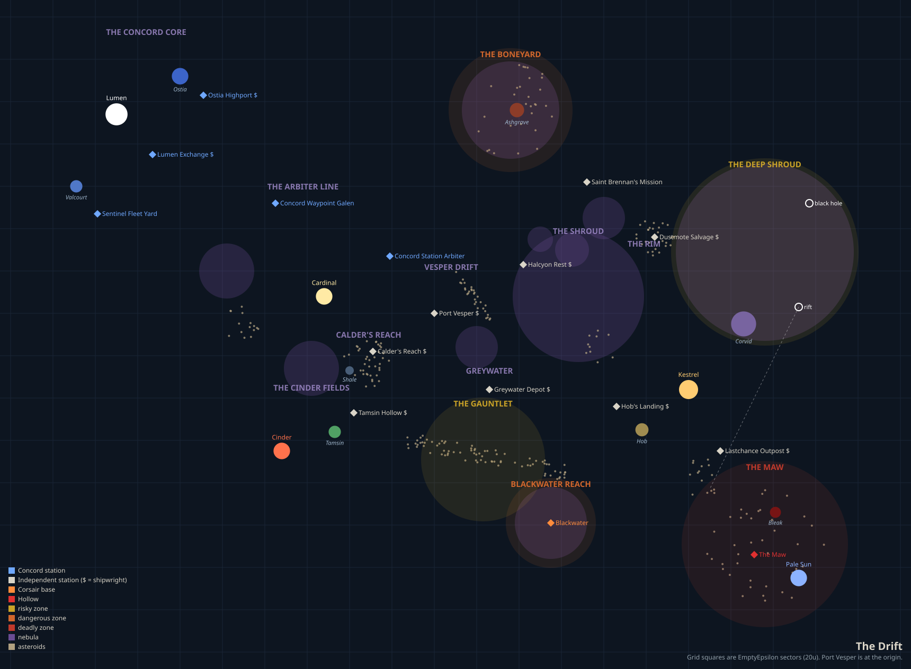

# The Drift

You're crew on an independent freighter at the edge of settled space. Money is tight. Law is far away. Everyone owes someone.

---

## The Universe

Five suns span the Drift. The same map every session — learn it, because navigation is survival.

**Lumen (Core)** — Rich Concord worlds. Safe, expensive, and very well policed. Clean record required.

**Cardinal & Cinder (Border)** — The messy middle ground. **Port Vesper** sits here — neutral ground, everyone docks here, no questions asked.

**Kestrel (Rim)** — Frontier worlds. Law arrives late or not at all. Armed crews, rough stations, disputes settled outside.

**Pale Sun (The Maw)** — Past Lastchance Outpost, past the warnings. Nobody comes back.

---

## Factions

**The Concord** — The government. Won the Settlement War twenty years ago. Gray hulls, transponders always on. Be polite, keep your transponder on, don't run. If you're clean they're neutral. If you're wanted, they're a problem.

**Independents** — Traders, salvagers, drifters. People like you.

**Corsairs** — Pirates. Fast ships, light armor. They want your cargo. Avoid the Gauntlet if you can. If they close on you: run, fight (if you're upgraded), or drop cargo and hope.

**Relic Drones** — Automated warships from the Settlement War, still running combat protocols twenty years later. No hails, no negotiation. Stay out of the Boneyard until you're ready.

**The Hollow** — Heavy warships under the Pale Sun. Nobody knows what they want. Nobody who'd know has come back.

---

## Work

Dock at any station and hail them — ask **"Any work available?"** and they'll offer what they have. You can carry two active contracts. Each has a 20-minute clock.

Jobs range from simple deliveries to salvage recoveries, surveillance runs, hacking relays, and harder contracts that pay accordingly. Pay scales with distance and how dangerous the space you're heading into.

Reputation matters — and it's cumulative. Complete a contract for a faction and you gain standing equal to the payout. Let one expire and you lose it. Destroy a ship and you lose 200 with that faction immediately. Disable a ship during a boarding run costs 100. There's no cap — reputation can climb well into the hundreds or plummet deep negative over a campaign.

---

## Upgrades

Your starting ship is a freighter — decent shields, basic weapons, warp drive. Stations stock different upgrades; ask around. Upgrade shields before venturing into risky space. The warp coil overhaul is the big mobility upgrade if you're covering long distances.

---

## Survival Tips

- **Start near the Core and Border.** Learn the ship before the Rim eats you.
- **Scan everything.** Science can tell you what's worth chasing and what to run from.
- **The Gauntlet has Corsairs.** The Boneyard has war drones. The Maw has things worse than both.
- **If a region says dangerous, believe it.**
- **Don't go to the Maw.**

---

If you hear the Shroud singing, maybe don't answer.

Fly safe.
