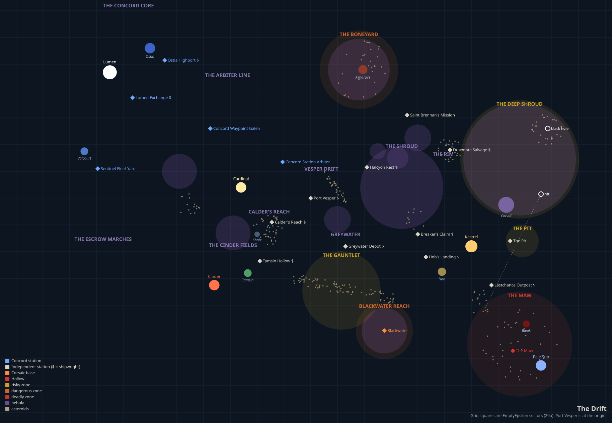

# The Drift

You're crew on an independent freighter at the edge of settled space. Money is tight. Law is far away. Everyone owes someone.

Ragtag is a custom scenario for [Empty Epsilon](https://github.com/daid/EmptyEpsilon), the open-source
spaceship bridge simulator. It needs Empty Epsilon EE-2026.09.22PR or newer.

---

## Two Ways to Play

**The Drift** — the campaign. Your ship's credits, upgrades and reputation carry over from session to
session, and the Drift has stories waiting for a crew who goes looking.

**The Short Haul** — a race. Every crew gets the same stock freighter and the same 200 credits, the
clock runs for 15, 30 or 60 minutes, and the richest ship when it runs out wins (credits plus what your
upgrades cost, so buying upgrades never costs you your place). A live leaderboard and the clock show on
Relay, Operations and the combined stations. Nothing is saved.

---

## The Universe

Five suns span the Drift. The same map every session — learn it, because navigation is survival.

**Lumen (Core)** — Rich Concord worlds. Safe, expensive, and very well policed. Clean record required.

**Cardinal & Cinder (Border)** — The messy middle ground. **Port Vesper** sits here — neutral ground, everyone docks here, no questions asked.

**Kestrel (Rim)** — Frontier worlds. Law arrives late or not at all. Armed crews, rough stations, disputes settled outside.

**Pale Sun (The Maw)** — Past Lastchance Outpost, past the warnings. Nobody comes back.

---

## Factions

**The Concord** — The government. Won the Settlement War twenty years ago. Gray hulls, transponders always on. Good standing means they wave you through. Bad standing means inspections, fines, and warp jammers. Very bad standing means they shoot on sight.

**Independents** — Traders, salvagers, drifters. People like you.

**Corsairs** — Pirates. Fast ships, light armor. They want your cargo. Avoid the Gauntlet if you can. If they close on you: run, fight (if you're upgraded), or drop cargo and hope.

**Relic Drones** — Automated warships from the Settlement War, still running combat protocols twenty years later, along with the old gun platforms that never stood down. They don't negotiate. Stay out of the Boneyard until you're ready.

**The Hollow** — Heavy warships under the Pale Sun. Nobody knows what they want. Nobody who'd know has come back.

---

## Work

Dock at any station and hail them — ask **"Any work available?"** and they'll offer what they have. Each ship can carry two active contracts; Relay shows them, and what to do next ("Deliver to Halcyon", "Return to Vesper"). Every contract has a clock, longer for longer runs; Relay counts it down under the job ("Time left 12:34").

Jobs range from simple deliveries and salvage recoveries to escorting convoys, shadowing ships, hacking relays, and harder contracts that pay accordingly. Pay scales with distance and how dangerous the space you're heading into. Bigger contracts open up as you invest in your ship.

Reputation matters, and every ship keeps its own. Finish jobs and stations offer more work; let them fail and the boards go quiet. The Concord remembers if you've been helpful or if you've run from an inspection. Shooting a ship that wasn't shooting at you costs standing with its people; fighting off pirates and hostile patrols doesn't. It carries across sessions.

---

## Upgrades

Your starting ship is a Light Freighter — decent shields, basic weapons, warp drive, two homing missiles and a two-person engineering crew. Every shipwright specialises: each one fits a few kinds of upgrade (hull, shields, beams, missiles, engines, thrusters, sensors, probes, the reactor, more engineering crew), and Science's database lists which in its **Ports** entries. Upgrade shields before venturing into risky space; faster turning and acceleration help you get out of trouble.

---

## Survival Tips

- **Start near the Core and Border.** Learn the ship before the Rim eats you.
- **Scan everything.** Science can tell you what's worth chasing and what to run from.
- **The Gauntlet has Corsairs.** The Boneyard has war drones. The Maw has things worse than both.
- **If a region says dangerous, believe it.**
- **Don't go to the Maw.**

---

If you hear the Shroud singing, maybe don't answer.

Fly safe.
