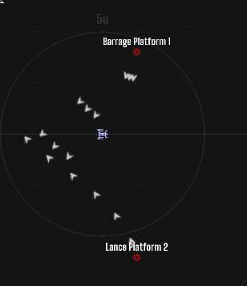

# Gun platforms

Stationary weapon platforms that track enemy player ships and fire HVLI shells.
Lives in `ee/ragtag/CustomObjects/platforms/` (installed to `scripts/ragtag/CustomObjects/platforms/`).
Ported from the **Barrage** and **Lance** platforms in *Unstable 235*
(`scenario_69_unstable235.lua`, EE-2024.12.08) to the EE-2026.09.22PR engine.

| Kind | Barrels | Cadence | Feel |
|---|---|---|---|
| `barrage` | 3, in a tight fan 8° apart | every 4.8 s | a spread of shells sweeping across the ship |
| `lance` | 1 | every 2.8 s | one fast stream walked back and forth over the ship |



## Behaviour

- **Range:** a platform fires whenever the nearest enemy player ship is within its
  `max_range`, all the way down to point blank. Getting in close doesn't help.
  To give crews a safe pocket under the guns, set `min_range_fraction`
  (e.g. `0.2` = holds fire inside 20% of range).
- **Aim:** it turns toward that ship at `turn_rate` (45°/s) and doesn't fire until
  it's pointed at it. It starts turning at 150% of range, so it's usually already
  facing the ship when the ship enters the band.
- **Strafe:** while firing, the aim sweeps **10° either side** of the ship, one full sweep
  every 3 s. Ships sitting still get hit; ships moving across the line can slip between sweeps.
- Shells fly just past `max_range` (5% overshoot) and then expire. Each does 10 damage
  (stock HVLI). Platforms only shoot at factions hostile to them (`isEnemy`).

## Using it

```lua
require("ragtag/CustomObjects/platforms/platforms.lua")

function init()
    VERSE.setupFactions()
    VERSE.build{session = 1}
    local x, y = VERSE.at("Some Place", 6, -3)          -- 6u east, 3u north of a universe place
    PLATFORMS.spawn{kind = "barrage", x = x, y = y, faction = "Corsairs"}
    PLATFORMS.spawn{kind = "lance",   x = x + 4000, y = y, faction = "Corsairs", max_range = 8000}
end

function update(delta)
    PLATFORMS.update(delta)
end
```

Any value in `PLATFORMS.defaults` or `PLATFORMS.kinds` can be overridden per platform:
`template`, `callsign`, `max_range`, `min_range_fraction`, `turn_rate`, `strafe_degrees`,
`strafe_period`, `barrels`, `fan_spread`, `interval`, `shell_speed`, `shell_damage`, `aim`
(starting heading). `PLATFORMS.spawn` returns the station, so `setHull`, `setShieldsMax`,
`setCanBeDestroyed`, etc. work as usual. Dead platforms drop out of the list automatically.

Try it: the **Platform Range (test)** scenario (`scenarios/platform_range/`) puts one of
each kind in front of an Atlantis.

## Porting notes (EE-2024.12.08 → EE-2026.09.22PR)

- The original fired shells with `HVLI():setPosition(...):setRotation(...):setLifetime(...)`.
  **The new engine has no `HVLI()` constructor**, so that line throws a LUA-Error on the first shot.
  `fireShell()` builds the shell from components instead (`missile_flight`, `explode_on_touch`,
  `lifetime`, `physics`, `radar_trace`, `radar_signature`, `constant_particle_emitter`, `sfx`), the same
  set and values the engine uses for a tube-fired HVLI (`MissileSystem::spawnProjectile`).
- The engine also gives HVLIs `destroyed_by_area_damage`, which can't be set from Lua. The only
  difference: EMP and energy blasts don't shoot these shells down.
- Shells carry `explode_on_touch.owner = platform`, so a platform can't hit itself.
  (The original relied on spawning shells 800 units out instead.)
- The original's settings (`Enemies` difficulty, the `Directorate` faction, warp-in effects,
  sector garrisons) were specific to that scenario and aren't carried over; pass `faction`
  and tune `interval`/`barrels` per platform instead.

Tested on EE-2026.09.22PR, headless. Fires from point blank out to 100% of range and holds
beyond it (7.9u fires and 8.1u holds for an 8u lance). Doesn't fire until aimed. Sweep stays within ±10°
of the target bearing. Shells damage the player ship. No LUA-Errors in the log.
